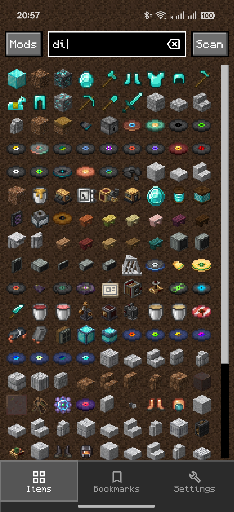
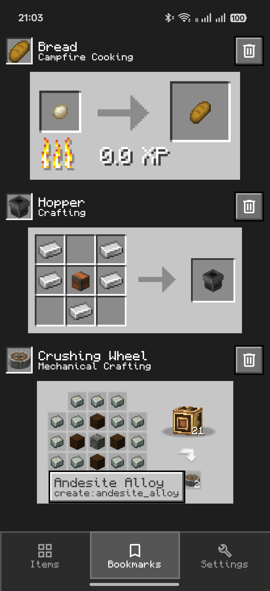
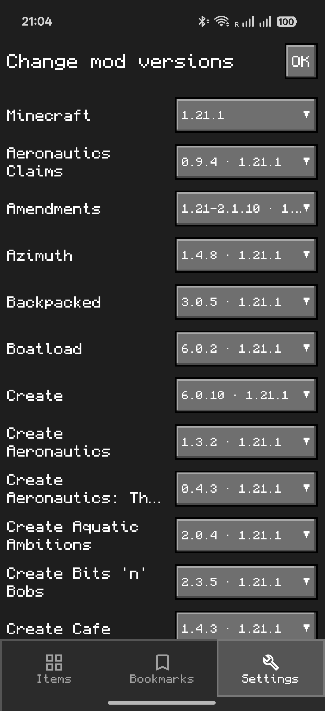

# Recipehost

Mobile app + companion Minecraft mod for offline recipe browsing. Download recipes once via QR code over LAN, then browse on mobile device. For any modpack!

## Features

### Search items from offline catalog


### Browse item's recipes and uses (including modded recipe types)


### Save chosen recipes for fast access


### Select from multiple mod versions saved in catalog


## Requirements

### Mod
The mod is client only.
- Minecraft 1.21.1
- Fabric Loader >= 0.15 + Fabric API OR neoforge 21.1
- Optional: EMI is required for full support of custom recipe types from mods.

### Mobile app
- Android 7.0
- iOS 16

## Development
Project is developed using AI agents. Conventional commits format is used. Issues and PRs are welcome.

### Overview
`shared/` - Mobile app shared code in KMP and Compose Multiplatform.

`androidApp/` - Android wrapper

`iosApp` - iOS wrapper

`protocol` - protobuf definitions of wire protocol

`mod` - Minecraft mod, divided in common and loader specific code using Architectury

### Building

Java 21 and Xcode 26.2 are required.

Android app:

```bash
./gradlew :androidApp:assembleDebug
```
```bash
./gradlew :androidApp:assembleRelease
```

iOS app:

```bash
xcodebuild -project iosApp/iosApp.xcodeproj -scheme iosApp -configuration Debug -destination 'generic/platform=iOS' -derivedDataPath build/ios
```

```bash
xcodebuild -project iosApp/iosApp.xcodeproj -scheme iosApp -configuration Release -destination 'generic/platform=iOS' -derivedDataPath build/ios
```

Mod (fabric):
```bash
./gradlew :mod:fabric:assemble
```

Mod (neoforge):
```bash
./gradlew :mod:neoforge:assemble
```

### License
[MPL 2.0](LICENSE)

## Planned
- Visualize crafting tree down to raw materials
- Better support for modpacks without EMI
- Newer versions of MC

