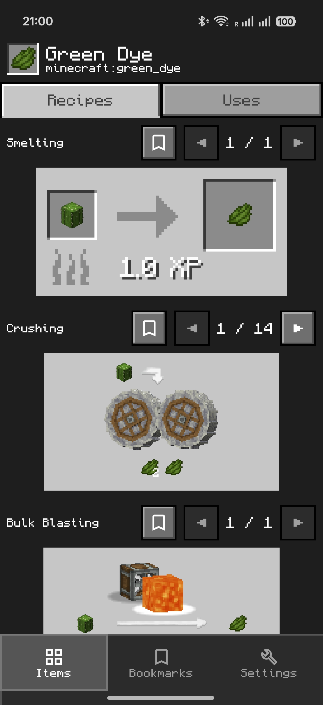

# Recipehost

Mobile app + companion Minecraft mod for offline recipe browsing. Download recipes once via QR code over LAN, then browse on mobile device. For any modpack!

## Features

### Search items from offline catalog
 

### Browse item's recipes and uses (including modded recipe types)



### Save chosen recipes for fast access


### Select from multiple mod versions saved in catalog


## Requirements

### Mod
The mod is client only.
- Minecraft 1.21.1
- Fabric Loader >= 0.15 + Fabric API OR neoforge 21.1
- Optional: EMI is required for full support of custom recipe types from mods.

### Mobile app
- Android 7.0
- iOS 16

## How it works

Mobile app connects to TCP listener inside Minecraft mod by using IP, port and addr encoded in QR code. On scan, mod collects all items, icons, recipes and recipe layouts. Then all collected data is incrementally saved to local database, to allow browsing recipes from multiple instances.

In order to support custom recipe types with its own gui, recipe layouts are captured as images with item slot positions. To capture such recipes, EMI is used, as it provides API to inspect its layout and inputs and has compatibility with JEI plugins.


## Development
Project is developed using AI agents. Conventional commits format is used. Issues and PRs are welcome.

### Overview
`shared/` - Mobile app shared code in KMP and Compose Multiplatform.

`androidApp/` - Android wrapper

`iosApp` - iOS wrapper

`protocol` - protobuf definitions of wire protocol

`mod` - Minecraft mod, divided in common and loader specific code using Architectury

### Building

Java 21 and Xcode 26.2 are required.

Android app:

```bash
./gradlew :androidApp:assembleDebug
```
```bash
./gradlew :androidApp:assembleRelease
```

iOS app:

```bash
xcodebuild -project iosApp/iosApp.xcodeproj -scheme iosApp -configuration Debug -destination 'generic/platform=iOS' -derivedDataPath build/ios
```

```bash
xcodebuild -project iosApp/iosApp.xcodeproj -scheme iosApp -configuration Release -destination 'generic/platform=iOS' -derivedDataPath build/ios
```

Mod (fabric):
```bash
./gradlew :mod:fabric:assemble
```

Mod (neoforge):
```bash
./gradlew :mod:neoforge:assemble
```

### License
[MPL 2.0](LICENSE)

## Planned
- Visualize crafting tree down to raw materials
- Better support for modpacks without EMI
- Newer versions of MC

